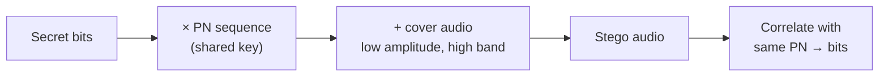

<h1 align="center">🎧 Audio Steganography · Spread Spectrum</h1>

Spread a secret message across the whole spectrum with a secret PN key — hard to hear, hard to find.

  
  
  

> **Docs only.** Results and plots are from the original notebook, which isn't in this repo.
> [Details →](#status--known-issues)

## Result

| Metric (cover vs stego) | Value |
|---|---|
| **SNR** | **40.3 dB** (imperceptible) |
| **MSE** | 1.4 × 10⁻⁶ |

## How it works

**Why DSSS:** low probability of detection, tolerance to noise, and no extraction without the PN key.

<table>
  <tr>
    <td width="50%"> Cover vs stego correlation</td>
    <td width="50%"> RMS energy</td>
  </tr>
</table>

## Status & known issues

| Issue | Effect |
|---|---|
| **No code in the repo** | Results can't be reproduced from here |
| Bit-error rate (BER) not reported | Recovery accuracy is unknown |
| High-band embedding | MP3 compression strips high frequencies and can destroy the message |
| Robustness vs imperceptibility | A stronger signal is easier to recover but more audible |

## Roadmap

- [ ] Upload the notebook and sample audio
- [ ] Report BER, with error-correcting codes (Hamming / Reed–Solomon)
- [ ] MP3, noise and resampling attack tests
